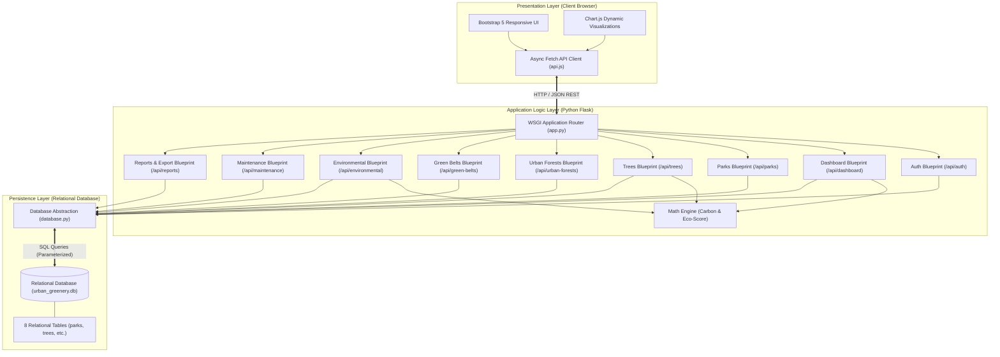
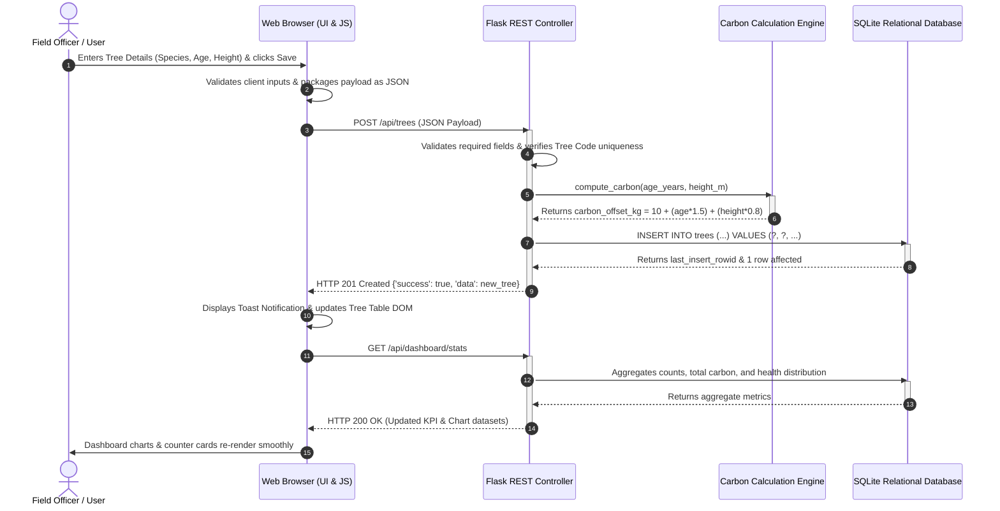
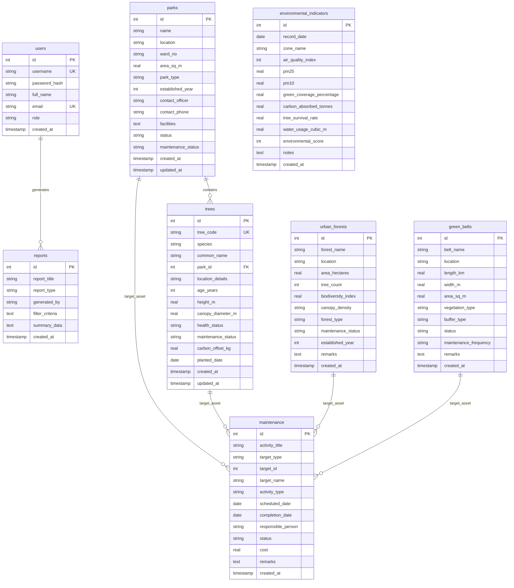
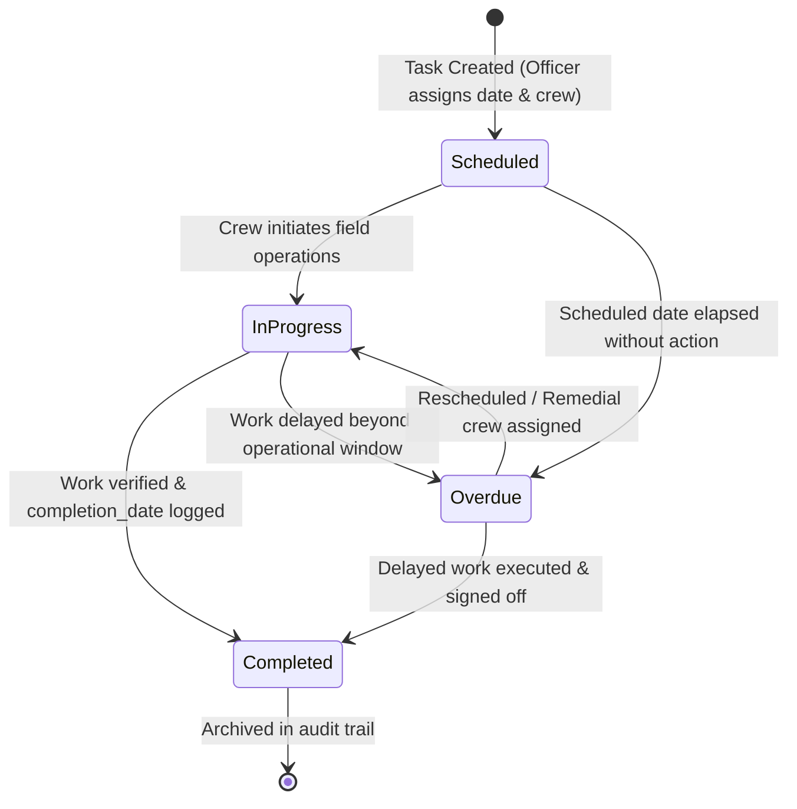

# PROJECT REPORT

## DIGITAL URBAN GREENERY MANAGEMENT SYSTEM
**A Centralized Web-Based Platform for Municipal Green Assets, Tree Census, and Environmental Monitoring**

---

### Executive Summary

Rapid urbanization has exacerbated challenges related to microclimates, particulate air pollution, biodiversity depletion, and urban heat island (UHI) phenomena. Municipal authorities often face critical operational bottlenecks due to fragmented record-keeping across paper registers and disparate spreadsheets. Consequently, urban forestry and horticulture departments lack real-time visibility into tree canopy health, spatial green distribution, maintenance backlogs, and carbon sequestration performance.

The **Digital Urban Greenery Management System (DUGMS)** is an end-to-end full-stack web application designed to serve as a digital command center for municipal greenery. The system provides integrated modules for managing public parks, maintaining an individual biometric tree census, monitoring dense Miyawaki urban forests, cataloging linear roadside green belts, capturing environmental sensor indicators (AQI, PM2.5, PM10, tree survival rate, water usage), scheduling maintenance work orders, and compiling verifiable audit reports with one-click CSV export capability.

---

## 1. Introduction & Background

### 1.1 Problem Statement
Urban environmental authorities encounter multiple operational challenges:
1. **Data Fragmentation & Loss:** Disconnected physical logs make it difficult to determine tree counts, mortality rates, and species distributions across municipal wards.
2. **Absence of Ecological Intelligence:** Cities struggle to calculate annual greenhouse gas (CO₂) sequestration metrics or correlate tree health with local air quality indexes (AQI).
3. **Reactive Maintenance:** Lack of structured workflow scheduling leads to overlooked pruning, delayed pest control interventions, and water inefficiency.
4. **Tedious Audit & Reporting:** Preparing environmental compliance filings for state or national regulatory bodies requires weeks of manual data compilation.

### 1.2 Project Objectives
- Build a centralized relational database cataloging municipal green assets with geographic, biometric, and operational attributes.
- Provide a responsive, real-time dashboard delivering key performance indicators (KPIs) and interactive visual analytics.
- Automate calculations for tree-level and forest-level carbon sequestration using established allometric models.
- Implement an automated composite **Environmental Eco-Score** algorithm combining air quality, canopy density, and vegetation survival rates.
- Streamline maintenance scheduling with one-click status transitions and cost audits.
- Offer dynamic report generation and filtered CSV dataset export capabilities.

### 1.3 Scope of the System
The system is scoped for urban local bodies (ULBs), municipal corporations, environmental non-profits, and smart city administration teams. It encompasses 9 core functional modules operating on a secure role-based access model (Administrator and Field Officer).

---

## 2. System Architecture & Flow Diagrams

The system follows a standard **3-Tier Client-Server Architecture** characterized by clean separation of concerns:
1. **Presentation Layer (Frontend):** Modern HTML5, CSS3, Bootstrap 5.3, and Chart.js communicating via asynchronous Fetch APIs.
2. **Application / Logic Layer (Backend):** Python Flask RESTful API utilizing modular Blueprints, input validators, error handlers, and business logic algorithms.
3. **Data Layer (Database):** Relational database (SQLite/MySQL/PostgreSQL compatible) enforcing referential integrity and performance indexing.

### 2.1 High-Level 3-Tier System Architecture



---

### 2.2 End-to-End Request & Data Flow (Sequence Diagram)

The following sequence illustrates the lifecycle of a typical client interaction—registering a tree record, computing its carbon sequestration metric, persisting the data, and updating the client interface dynamically:



---

### 2.3 Entity-Relationship Diagram (ERD)

The relational schema strictly enforces foreign key constraints, default timestamps, and uniqueness rules:



---

### 2.4 Maintenance Task State Machine

The maintenance management subsystem implements a finite state model ensuring work orders move predictably through audit stages:



---

## 3. Mathematical & Algorithmic Models

The system incorporates domain-specific ecological models implemented in backend Python routines:

### 3.1 Allometric Carbon Sequestration Model
Individual tree annual carbon offset is estimated using standard arboricultural allometric relationships based on tree maturity and physical dimensions:

$$\text{CO}_2\text{ Offset (kg/yr)} = 10.0 + (\text{Age (years)} \times 1.5) + (\text{Height (m)} \times 0.8)$$

- Where biometric data is unavailable, the system defaults to the international baseline benchmark for mature temperate/tropical trees: **$22.0\text{ kg CO}_2\text{/tree/year}$**.
- For dense Miyawaki forests, aggregate sequestration is computed across the cataloged tree census:

$$\text{Total Forest Sequestration (Tonnes)} = \frac{\sum_{i=1}^{N} \text{Tree Count}_i \times 22.0}{1000.0}$$

### 3.2 Composite Environmental Eco-Score Index
To normalize divergent environmental parameters (air pollution, canopy coverage, irrigation hydration, sapling survival) into an intuitive municipal indicator ($1 \text{ to } 100$), the system calculates:

$$\text{Eco Score} = 50.0 - \text{Penalty}_{\text{AQI}} + \text{Bonus}_{\text{Coverage}} + \text{Bonus}_{\text{Survival}}$$

Where:
$$\text{Penalty}_{\text{AQI}} = \max\left(0, (\text{AQI} - 50) \times 0.25\right)$$
$$\text{Bonus}_{\text{Coverage}} = \text{Green Coverage \%} \times 0.6$$
$$\text{Bonus}_{\text{Survival}} = (\text{Tree Survival Rate \%} - 70) \times 0.5$$

- The resulting score is constrained within the range $[10, 99]$.
- A score of $\ge 85$ indicates **Eco Grade A** (optimal balance of canopy volume, clean air, and high survival).

---

## 4. Module Specifications & Technical Implementation

| Module | Primary Interface File | Backend Blueprint | Key Functional Capabilities |
| :--- | :--- | :--- | :--- |
| **Authentication** | `login.html`, `auth.js` | `auth.py` | SHA-256 password hash verification, role enforcement (`admin`, `officer`), session management via `localStorage`. |
| **Dashboard** | `index.html`, `dashboard.js` | `dashboard.py` | Real-time aggregate KPIs (Total parks, trees, forest acreage, annual CO₂ tonnes), Chart.js species bar chart, health status donut, multi-line environmental trend. |
| **Park Management** | `parks.html`, `parks.js` | `parks.py` | Full CRUD operations, acreage filtering, ward categorization, and relational tree inspector displaying trees planted in each park. |
| **Tree Inventory** | `trees.html`, `trees.js` | `trees.py` | Tree census, automated tree code assignment (`TR-YYYY-XXX`), biometric height/age tracking, health rating badges, carbon calculation. |
| **Urban Forests** | `urban-forests.html`, `urban-forests.js` | `urban_forests.py` | Tracking dense Miyawaki reserves, biodiversity rating index ($1.0 - 5.0$), canopy density categorization (Dense, Medium, Low). |
| **Green Belts** | `green-belts.html`, `green-belts.js` | `green_belts.py` | Linear buffer tracking, automatic surface area calculation ($L\text{ [km]} \times 1000 \times W\text{ [m]}$), buffer classification (Roadside, Industrial, Coastal). |
| **Environmental Performance** | `environmental.html`, `environmental.js` | `environmental.py` | Microclimate observations (AQI, PM2.5, PM10, green coverage %, water usage), multi-zone comparison charts, automated Eco-Score evaluation. |
| **Maintenance Management** | `maintenance.html`, `maintenance.js` | `maintenance.py` | Work order scheduling across all asset types, status tagging (`Scheduled`, `In Progress`, `Completed`, `Overdue`), 1-click completion patch. |
| **Reports & Export** | `reports.html`, `reports.js` | `reports.py` | Dynamic compilation of executive audits, instant CSV dataset streaming via Python `csv.writer`, clean `@media print` print-friendly styling. |
| **Universal Search** | `api.js` (Top Navigation) | `reports.py` | Real-time debounced search dropdown querying parks, trees, forests, and green belts simultaneously. |

---

## 5. Software Quality Assurance & Testing

### 5.1 Test Methodology
A comprehensive automated test suite was developed using Python's native `unittest` framework (`tests/test_app.py`). The test harness operates on an isolated Flask test client, verifying HTTP response status codes, payload structures, calculation results, and database transactional integrity.

### 5.2 Test Matrix & Verification Results

| Test ID | Target Component | Test Case Description | Expected Result | Status |
| :--- | :--- | :--- | :--- | :--- |
| **TC-01** | Root API | Ping `/api` health check endpoint | HTTP 200, `status: 'online'` | **PASSED** |
| **TC-02** | Auth Module | Valid login (`admin:admin123`) & Invalid password rejection | HTTP 200 with user profile; HTTP 401 on bad password | **PASSED** |
| **TC-03** | Dashboard API | Compute aggregate statistics and chart series | HTTP 200, non-zero parks/trees, arrays for species/health | **PASSED** |
| **TC-04** | Parks Module | Complete lifecycle: Create $\rightarrow$ Read $\rightarrow$ Update $\rightarrow$ Delete | HTTP 201/210 on creation, 200 on edit, 200 on deletion, 404 on re-fetch | **PASSED** |
| **TC-05** | Trees Module | Add tree, verify automated carbon computation, update health | HTTP 201, carbon offset matches formula, HTTP 200 on update | **PASSED** |
| **TC-06** | Urban Forests | Add Miyawaki forest, verify biodiversity rating, delete | HTTP 201, correct acreage and tree count, HTTP 200 on cleanup | **PASSED** |
| **TC-07** | Green Belts | Register roadside corridor, check dimension math, delete | HTTP 201, area computed as $L \times W$, HTTP 200 on deletion | **PASSED** |
| **TC-08** | Environmental | Log AQI & water metrics, fetch multi-zone analytics | HTTP 201, calculated eco score within $[10, 99]$, 200 on analytics | **PASSED** |
| **TC-09** | Maintenance | Schedule work order, perform quick 1-click status patch | HTTP 201, PATCH updates status to 'Completed' with today's date | **PASSED** |
| **TC-10** | Reports & CSV | Compile summary audit & stream raw CSV file download | HTTP 201 report created; HTTP 200 with `text/csv` header | **PASSED** |

**Execution Result:**
```text
----------------------------------------------------------------------
Ran 10 tests in 0.803s
OK
```

---

## 6. Challenges Encountered & Engineering Solutions

1. **Database Multi-RDBMS Compatibility:**
   - *Challenge:* Ensuring that the application works seamlessly on a standard student laptop with zero prerequisite software, while simultaneously providing enterprise-grade SQL compatibility for production MySQL/PostgreSQL deployment.
   - *Solution:* Implemented a database abstraction layer (`backend/database.py`) using standard SQL datatypes, dynamic auto-initialization from `schema.sql` and `seed_data.sql`, and row-factory dictionaries.
2. **Dynamic Mathematical Imputation:**
   - *Challenge:* Missing or partial biometric values (e.g. unknown tree planting date or height) led to null carbon values in naive calculations.
   - *Solution:* Engineered fallback interpolation logic in Python calculating estimated carbon from age and height where available, and falling back gracefully to the international arboricultural constant of $22.0\text{ kg/year}$.
3. **Canvas Distortion in Responsive Layouts:**
   - *Challenge:* Chart.js `<canvas>` elements distorted or overflowed when viewport widths transitioned between mobile and multi-column desktop displays.
   - *Solution:* Wrapped each chart in a parent container with relative positioning and fixed height constraints, configured `maintainAspectRatio: false`, and utilized Bootstrap responsive grid breakpoints (`col-xl`, `col-lg`, `col-md`).
4. **Relational Deletion Integrity:**
   - *Challenge:* Deleting a park record with assigned trees could cause orphaned references or foreign key violation crashes.
   - *Solution:* Added `FOREIGN KEY (park_id) REFERENCES parks(id) ON DELETE SET NULL` constraints so tree records remain intact as unassigned/roadside greenery rather than crashing the system.

---

## 7. Future Enhancements

1. **GIS & Geospatial Satellite Mapping:** Incorporate Leaflet.js or Mapbox GL to visualize geospatial tree coordinates, park boundary polygons, and NDVI (Normalized Difference Vegetation Index) satellite imagery overlays.
2. **IoT Sensor Ingestion Pipeline:** Connect automated MQTT sensor endpoints for continuous real-time logging of soil moisture, ambient humidity, and solar radiation in high-density Miyawaki reserves.
3. **Computer Vision Disease Classification:** Develop a companion deep-learning classifier (MobileNet / YOLO) enabling field arborists to upload photographs of tree leaves or bark to identify borer infestations and fungal blights.
4. **Offline-First Field Progressive Web App (PWA):** Implement service workers and IndexedDB storage so field workers can catalog trees in rural parks with zero cellular reception and synchronize upon reconnection.

---

### Conclusion
The **Digital Urban Greenery Management System** demonstrates a full-stack, modular, and scientifically grounded solution to municipal urban forestry management. By unifying physical asset tracking with ecological carbon estimation, operational work orders, and dynamic data visualizations, the system empowers city planners to make informed, data-driven decisions that enhance urban sustainability and climate resilience.
